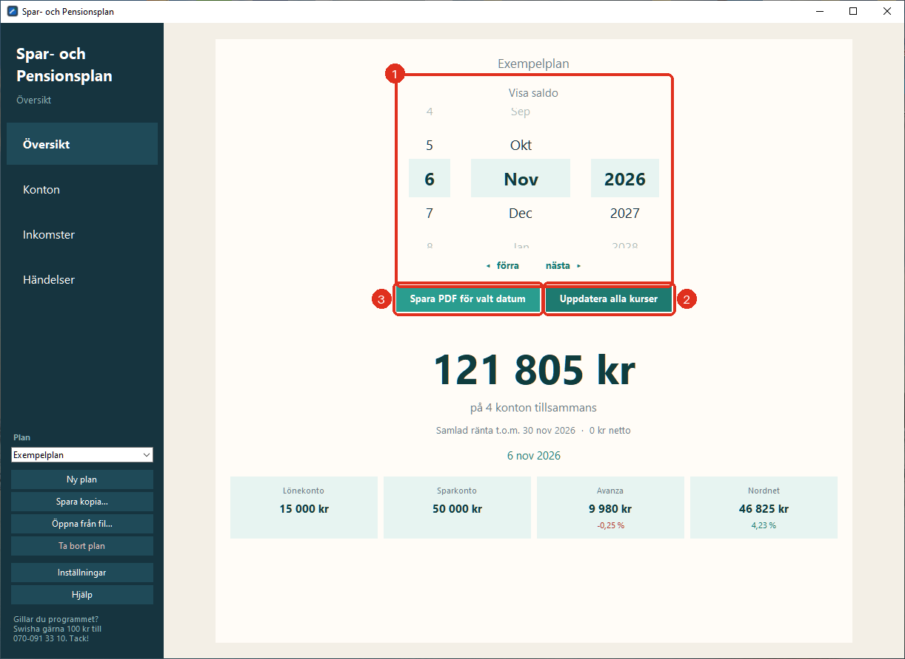
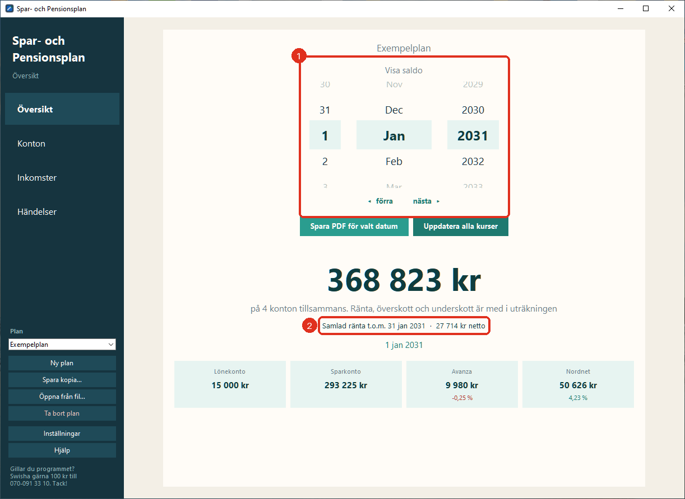
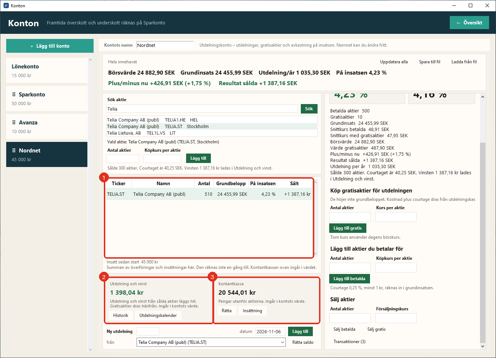

# Spar- och Pensionsplan

Ett gratis Windows-program för att hålla koll på konton och aktier i dag och se hur pengarna räcker och växer framåt, oavsett om du sparar till något eller planerar för pensionen.

> *Jag är amatör och har gjort programmet för eget bruk, med hjälp av AI. Jag delar det gärna, men det finns ingen garanti och ingen support. Det är ett planeringsverktyg, inte finansiell rådgivning.*

**Hemsida med bilder och installationshjälp: [magnusbaa.github.io/spar-och-pensionsplan](https://magnusbaa.github.io/spar-och-pensionsplan/)**

**Gillar du programmet? Swisha gärna 100 kr till 070-091 33 10. Tack!**

## Ladda ner

1. Gå till [senaste versionen](../../releases/latest) och klicka på **SparOchPensionsplan_Setup_1.0.exe** under *Assets*.
2. Dubbelklicka på filen när den har laddats ner.
3. Windows visar troligen en blå ruta: **Windows skyddade datorn**. Det beror på att programmet inte är signerat med ett betalt certifikat. Klicka på **Mer info** och sedan på **Kör ändå**.
4. Följ installationen. Programmet behöver inte administratörslösenord och kan tas bort som vanligt under *Inställningar → Appar*.

Första gången du startar programmet öppnas manualen, och du får skapa din första plan. Manualen finns också under **Hjälp** i programmet.

## Vad programmet kan

- **Konton** med saldo, ränta och skatt på ränta. Ränta varje månad eller en gång om året.
- **Insättningar, uttag och överföringar**, både sådant som har hänt och sådant som är planerat.
- **Inkomster och behov per månad**, för en eller två personer. Överskott och underskott hamnar på det konto du väljer.
- **Idag och framtiden**: på dagens datum visas det du verkligen har. Snurrar du fram i tiden visas en prognos med ränta, överskott och underskott.
- **Utdelningskonto** (till exempel Nordnet): köp aktier, registrera utdelningar, köp gratisaktier för utdelningen, se avkastning på insatsen och resultat på sålda aktier.
- **Kursvinstkonto** (till exempel Avanza): se hur aktierna har gått upp eller ner mot det du betalat.
- Börskurser hämtas från internet. Programmet är **inte kopplat till någon bank**, och kontona kan döpas till vad du vill.
- **PDF** med alla konton för valfritt datum.
- Allt sparas automatiskt på din egen dator.

## Bra att veta

- Fungerar bara på **Windows**.
- Internet behövs bara för att söka aktier och hämta kurser.
- Planerna sparas i mappen `planer` där programmet är installerat. Använd **Spara kopia…** om du vill ha en säkerhetskopia.

## För den som vill bygga själv

Programmet är skrivet i Python med Tkinter. Kör `bygg_installer.bat` (kräver Python och [Inno Setup 6](https://jrsoftware.org/isinfo.php)).
